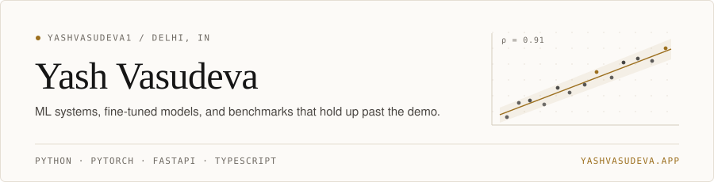
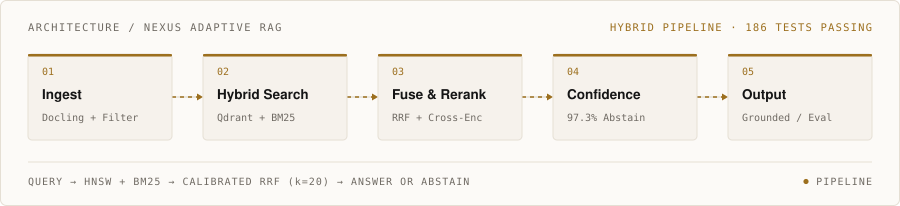
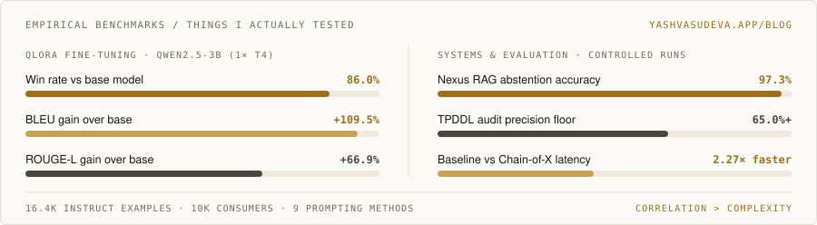

<picture>
  <source media="(prefers-color-scheme: dark)" srcset="./assets/header-dark.svg" />
  <source media="(prefers-color-scheme: light)" srcset="./assets/header-light.svg" />
  
</picture>

 

I build ML and retrieval systems, fine-tune small language models, and spend a slightly unreasonable amount of time testing whether popular AI advice actually holds up under controlled experiments. B.Tech IT student at BPIT, GGSIPU in Delhi; previously interned at Tata Power DDL working on electricity theft detection.

Most repos here start one of two ways: a production ML pipeline I wanted to stress-test properly, or a workflow that annoyed me enough to automate. I care a lot more about data signal, calibration, and honest evaluation than stacking parameters onto a weak baseline.

---

### Selected builds

<a href="https://github.com/yashvasudeva1/Production-oriented-adaptive-RAG">
  <picture>
    <source media="(prefers-color-scheme: dark)" srcset="./assets/pipeline-dark.svg" />
    <source media="(prefers-color-scheme: light)" srcset="./assets/pipeline-light.svg" />
    
  </picture>
</a>

  

| Build | What it is |
| :--- | :--- |
| [**qwen-data-science-instruct**](https://github.com/yashvasudeva1/qwen-data-science-instruct) | `Qwen2.5-3B-Instruct` fine-tuned on 16.4K data science examples using 4-bit QLoRA (Unsloth) on a single T4. 86% win rate over the base model (+109.5% BLEU, +66.9% ROUGE-L). |
| [**Nexus (Adaptive RAG)**](https://github.com/yashvasudeva1/Production-oriented-adaptive-RAG) | Confidence-gated hybrid retrieval (Qdrant HNSW + BM25, calibrated RRF, cross-encoder reranking) with a dual-filter extraction stage. 97.3% abstention accuracy on unanswerables, 186 tests passing. |
| [**ntl-detection**](https://github.com/yashvasudeva1/ntl-detection) | Electricity theft and meter tampering portal built during my Tata Power DDL internship. Tuned to a 65%+ audit precision floor across 10K consumers because false-positive field raids cost real money. |
| [**ResumeDojo**](https://github.com/yashvasudeva1/Resume_ops) | Resume parser and ATS auditor built with Docling, PyMuPDF, FastAPI, and Next.js. Extracts factual structure first, then scores bullets against 12+ tech roles without polite fluff. |
| [**ORCHESTRA**](https://github.com/yashvasudeva1/ORCHESTRA) · [live](https://orchestra-eosin.vercel.app) | Upload a CSV of hackathon submissions; five judge agents, a bias auditor, and a chief judge review the repos and return written feedback plus a ranked leaderboard. |

**Other tools worth a look**

- [**RAGForge**](https://github.com/yashvasudeva1/RAGForge) - drag-and-drop canvas for assembling custom RAG architectures and exporting runnable code.
- [**NewsRadar**](https://github.com/yashvasudeva1/NewsRadar) ([live](https://news-radar-ten.vercel.app)) - automated engineering blog and preprint research monitor with keyword scoring and daily Gmail briefings.
- [**AI-Text-Catcher-**](https://github.com/yashvasudeva1/AI-Text-Catcher-) - forensic stylometric and semantic pipeline for spotting AI-generated writing (which sets a fairly high bar for this README).
- [**Live-Youtube-Sentiment-Analyzer**](https://github.com/yashvasudeva1/Live-Youtube-Sentiment-Analyzer) - Chrome extension + backend script for live comment extraction and sentiment breakdown on YouTube videos.

---

### Things I actually tested

<a href="https://yashvasudeva.app/blog">
  <picture>
    <source media="(prefers-color-scheme: dark)" srcset="./assets/benchmarks-dark.svg" />
    <source media="(prefers-color-scheme: light)" srcset="./assets/benchmarks-light.svg" />
    
  </picture>
</a>

  

When a paper, blog post, or ML rule of thumb sounds suspicious, I run paired experiments and publish the charts on [yashvasudeva.app/blog](https://yashvasudeva.app/blog). A few findings that changed how I build:

- **Prompting techniques:** Plain baseline prompting beat all 9 Chain-of-X methods on output quality across 2 LLMs and 5 task types, at 2.27× lower latency.
- **Text preprocessing:** Controlled paired runs across 20 Newsgroups and IMDB showed classical preprocessing lifts topic F1 (`+0.043`) while hurting sentiment (`-0.011`).
- **LLM narrative collapse:** Across 4 open-weight models (82M to 410M), parameter count did not predict when long-form writing falls apart; knowledge distillation did.
- **Signal over model complexity:** Benchmarking 20+ regression and classification models across varying feature-target correlation, plus companion notebooks on evaluation traps ([`metric_trap`](https://github.com/yashvasudeva1/metric_trap)) and imbalanced datasets ([`data_fuel_ML`](https://github.com/yashvasudeva1/data_fuel_ML)).

---

### Skills & tooling

| Area | Stack |
| :--- | :--- |
| **Languages** | `Python` `TypeScript` `JavaScript` `SQL` `C` `C++` `Java` |
| **ML & Deep Learning** | `PyTorch` `TensorFlow` `scikit-learn` `XGBoost` `NumPy` `SciPy` `Unsloth` `QLoRA` `Hugging Face` `LSTM` |
| **LLM & Retrieval** | `Qdrant` `BM25` `Hybrid RAG` `Cross-Encoder Reranking` `LangChain` `Docling` `Multi-Agent Systems` `Gemini API` `OpenAI API` |
| **Data & Visualization** | `Pandas` `Matplotlib` `Seaborn` `Plotly` `Power BI` `Tableau` `MATLAB` |
| **Backend & Web** | `FastAPI` `Flask` `Next.js` `Node.js` `Streamlit` `PostgreSQL` `MySQL` `SQLite` |
| **Infra & Workflow** | `Docker` `Git` `GitHub Actions` `AWS` `Vercel` `Render` |

---

### Background

- **Tata Power Delhi Distribution Ltd. (TPDDL)** - Business Analyst Intern (Jun–Jul 2026). Built an ML portal for non-technical loss detection across 10,000 consumers using 12 smart-meter features.
- **BPIT, GGSIPU** - B.Tech in Information Technology (2024–Present, 8.75/10 CGPA).
- **Hackathons (9× podiums)** - Vultr Track Winner at HackCBS 9.0 (MLH), Gemini Track Winner at No//Code Hackathon (MLH), Finalist at Odoo Hackathon and Orbix Hackathon (IIIT Delhi).
- **Outside code** - Graphics Lead at Namespace BPIT, Secretary at Rotaract Club of BPIT, and design experiments under [The Design Forge](https://design-forge-iota.vercel.app).

---

<a href="https://yashvasudeva.app">
  <picture>
    <source media="(prefers-color-scheme: dark)" srcset="./assets/terminal-dark.svg" />
    <source media="(prefers-color-scheme: light)" srcset="./assets/terminal-light.svg" />
    
  </picture>
</a>

 

  <a href="https://yashvasudeva.app">yashvasudeva.app</a> ·
  <a href="https://yashvasudeva.app/projects">Projects</a> ·
  <a href="https://yashvasudeva.app/blog">Writing</a> ·
  <a href="https://www.linkedin.com/in/yash-vasudeva/">LinkedIn</a> ·
  <a href="https://x.com/YashVasudeva2">X</a> ·
  <a href="https://yashvasudeva.app/contact">Contact</a>

